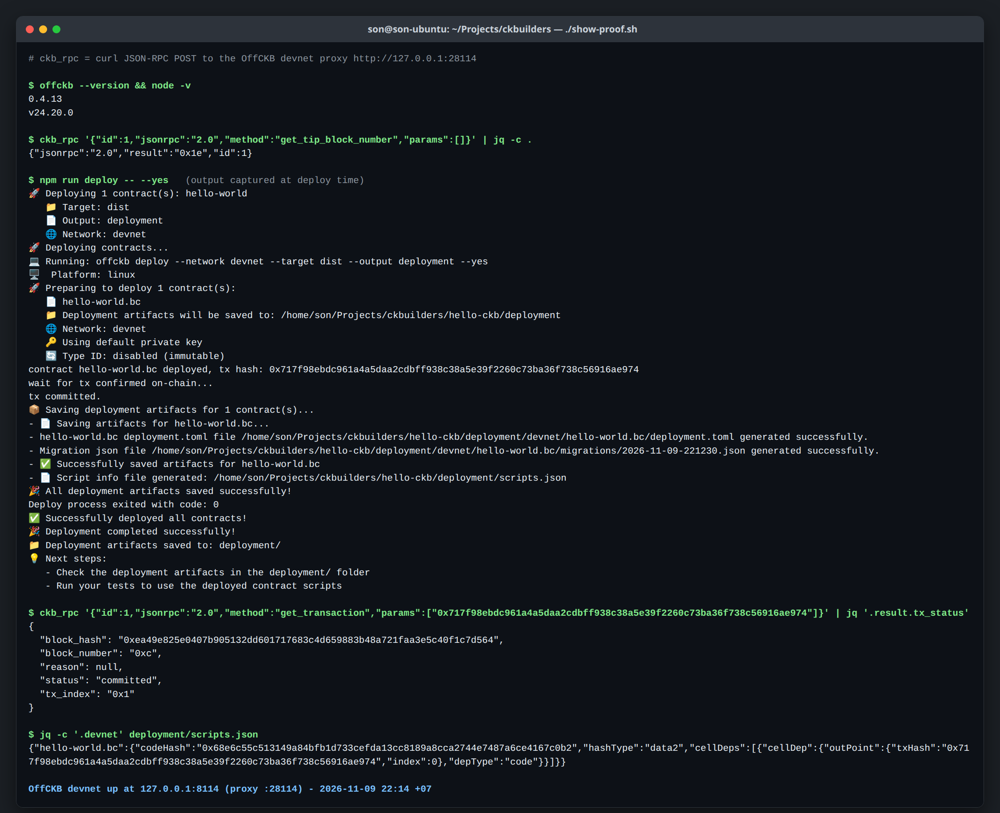

# CKBuilder

Dev log for the Nervos CKBuilder program. Weekly reports, notes and code from working through the CKBuilder handbook go here.

Reports are posted every Thursday.

See the [CKBuilder Handbook](https://docs.google.com/document/d/1aFHXU1ZL1MyIbBAIVRjG6stqdWwPUPyHV90O1QNwY-M/edit) for reporting standards.

## Onboarding

- **2026-11-09:** Got OffCKB 0.4.13 running a local devnet (CKB 0.208.0). Deployed the hello-world contract from the TypeScript template. The deploy tx `0x717f98eb...ae974` was committed in block 12.

## Week 1: OffCKB and the hello-world contract

**Name:** sonson0910

**Week ending:** 12 November 2026

**Reporting period:** 9 to 12 November 2026

### Courses Completed

- Completed CKB Academy lessons 1 and 2.
- Completed Intro to Script.

### Key Learnings

I have worked with Cardano before. This week I moved into new material: how CKB works as a chain.

In the manual return-code exercise, I observed an error after changing `return 0` to `return 1`.

### Practical Progress

I ran the OffCKB/hello-world labs myself, including the manual return-code exercise. Deployment and successful devnet transaction evidence are linked below.

### What Felt Easy or Challenging

The labs went smoothly for me because I have worked on other blockchain projects before. The harder part was reading the RPC output: I know the transaction was confirmed, but I still don't understand all the fields in the RPC response.

### Next Steps

Work through the Transfer CKB and Store Data on Cell tutorials in the Handbook. The next weekly report is scheduled for Thursday, 19 November 2026.

### Environment

Local OffCKB devnet with the TypeScript hello-world template.

### Evidence

These transaction hashes belong to the local devnet.

1. Deployment: `0x717f98ebdc961a4a5daa2cdbff938c38a5e39f2260c73ba36f738c56916ae974`.
2. Lab transaction from the participant's 17:25 run: `0x6d192576dcec05e4a39e7ee702d8263f8ef85a1a902b722b549d5eda3e8dccb2`. Committed in block 72, using 5,617,091 cycles.
3. [Participant terminal excerpts, including Lab 4](evidence/week-1-participant-run.log).
4. [Verification after restoring return 0](evidence/week-1-restored-test.log): the mock test passed.

The manual exercise produced the expected verification failure with `return 1`. After restoring `return 0` and rebuilding, a separate verification run passed.

### Original Participant Note

> toàn bộ lab đều do tôi chạy, khá là mượt vì trước đây tôi có làm các dự án khác về blockchain rồi
