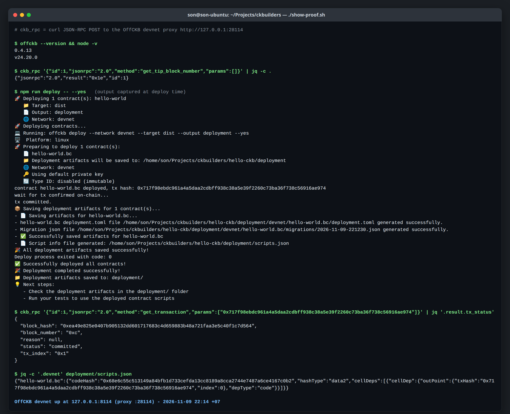
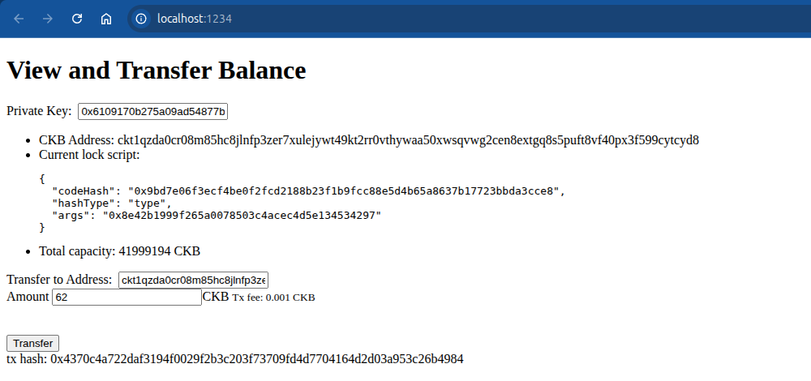
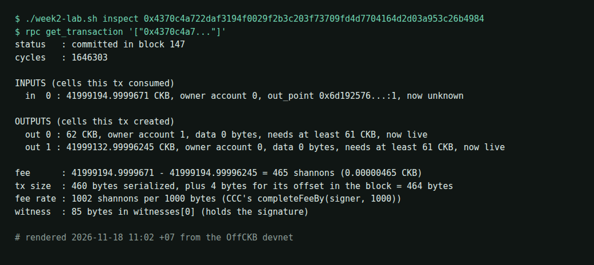
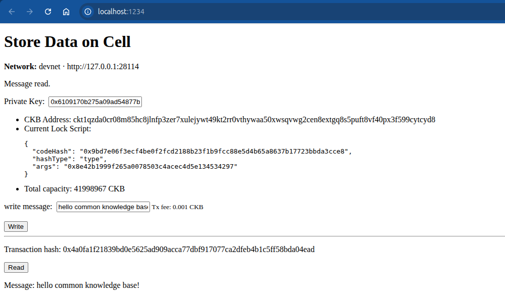
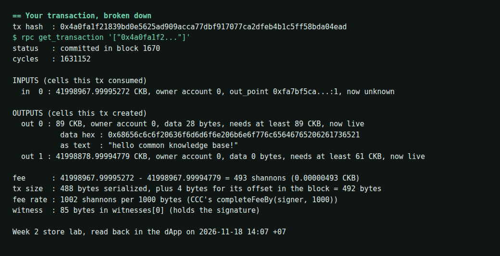

# CKBuilder

Dev log for the Nervos CKBuilder program. Weekly reports, notes and code from working through the CKBuilder handbook go here.

Reports are posted every Thursday.

See the [CKBuilder Handbook](https://docs.google.com/document/d/1aFHXU1ZL1MyIbBAIVRjG6stqdWwPUPyHV90O1QNwY-M/edit) for reporting standards.

## Onboarding

- **2026-11-09:** Got OffCKB 0.4.13 running a local devnet (CKB 0.208.0). Deployed the hello-world contract from the TypeScript template. The deploy tx `0x717f98eb...ae974` was committed in block 12.

## Week 1: OffCKB and the hello-world contract

**Name:** sonson0910

**Week ending:** 12 November 2026

**Reporting period:** 9 to 12 November 2026

### Courses Completed

- Completed CKB Academy lessons 1 and 2.
- Completed Intro to Script.

### Key Learnings

I have worked with Cardano before. This week I moved into new material: how CKB works as a chain.

In the manual return-code exercise, I observed an error after changing `return 0` to `return 1`.

### Practical Progress

I ran the OffCKB/hello-world labs myself, including the manual return-code exercise. Deployment and successful devnet transaction evidence are linked below.

### What Felt Easy or Challenging

The labs went smoothly for me because I have worked on other blockchain projects before. The harder part was reading the RPC output: I know the transaction was confirmed, but I still don't understand all the fields in the RPC response.

### Next Steps

Work through the Transfer CKB and Store Data on Cell tutorials in the Handbook. The next weekly report is scheduled for Thursday, 19 November 2026.

### Environment

Local OffCKB devnet with the TypeScript hello-world template.

### Evidence

These transaction hashes belong to the local devnet.

1. Deployment: `0x717f98ebdc961a4a5daa2cdbff938c38a5e39f2260c73ba36f738c56916ae974`.
2. Lab transaction from the participant's 17:25 run: `0x6d192576dcec05e4a39e7ee702d8263f8ef85a1a902b722b549d5eda3e8dccb2`. Committed in block 72, using 5,617,091 cycles.
3. [Participant terminal excerpts, including Lab 4](evidence/week-1-participant-run.log).
4. [Verification after restoring return 0](evidence/week-1-restored-test.log): the mock test passed.

The manual exercise produced the expected verification failure with `return 1`. After restoring `return 0` and rebuilding, a separate verification run passed.

## Week 2: Transfer CKB and Store Data on Cell

**Name:** sonson0910

**Week ending:** 19 November 2026

**Reporting period:** 13 to 19 November 2026

### Courses Completed

- Completed the Transfer CKB tutorial.
- Completed the Store Data on Cell tutorial.

### Key Learnings

1. The fee is the difference between total input and output capacity. For my transfer, it was 465 shannons.
2. When I spend a cell, I can reuse the CKB it held as capacity.
3. My transfer used about 1.6 million cycles to run the lock script that checks the signature.

### Practical Progress

I ran both tutorial dApps from the docs repo against the local OffCKB devnet, using devnet account 0 as the sender.

- Transfer CKB: sent 62 CKB to devnet account 1. The transaction consumed one input cell and created two outputs: 62 CKB for the receiver and the change back to account 0. The fee was 465 shannons.
- Store Data on Cell: wrote "hello common knowledge base!" (28 bytes) into a cell. The cell holds 89 CKB, which is the 61 CKB minimum for a plain cell plus 1 CKB per byte of data. I then read the message back in the dApp.

### What Felt Easy or Challenging

Both labs went smoothly. One thing was a bit confusing: my first Store Data on Cell transaction was already committed on chain, but the dApp page kept saying the message cell was not live yet.

### Next Steps

Work through the Create Fungible Token tutorial in the Handbook. The next weekly report is scheduled for Thursday, 26 November 2026.

### Environment

Local OffCKB 0.4.13 devnet (CKB 0.208.0). The `simple-transfer` and `store-data-on-cell` example dApps from nervosnetwork/docs.nervos.org, served locally on port 1234.

### Evidence

These transaction hashes belong to the local devnet.

1. Transfer: `0x4370c4a722daf3194f0029f2b3c203f73709fd4d7704164d2d03a953c26b4984`. Committed in block 147, using 1,646,303 cycles. [Transaction breakdown](evidence/week-2-transfer-breakdown.log).
2. First store write: `0x2aba70bbb733b3c0ba5cfa81346bd32cedea8ee56e483491291c7e3565a3008e`. Committed in block 223, but the dApp tab kept reporting that the message cell was not live yet. [Terminal output](evidence/week-2-store-first-run.log).
3. Store write read back in the dApp: `0x4a0fa1f21839bd0e5625ad909acca77dbf917077ca2dfeb4b1c5ff58bda04ead`. Committed in block 1670, using 1,631,152 cycles. [Transaction breakdown](evidence/week-2-store-read-breakdown.log).

