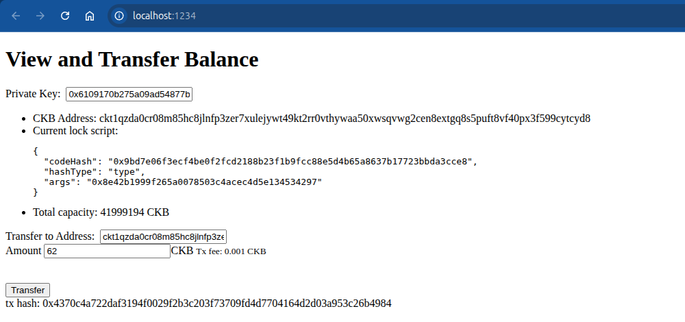
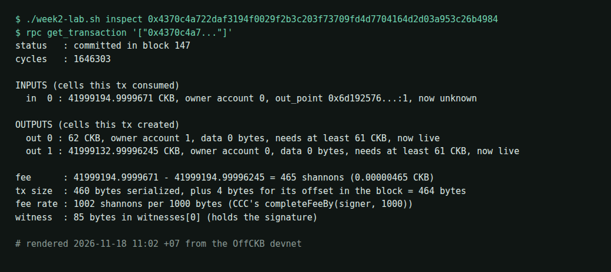
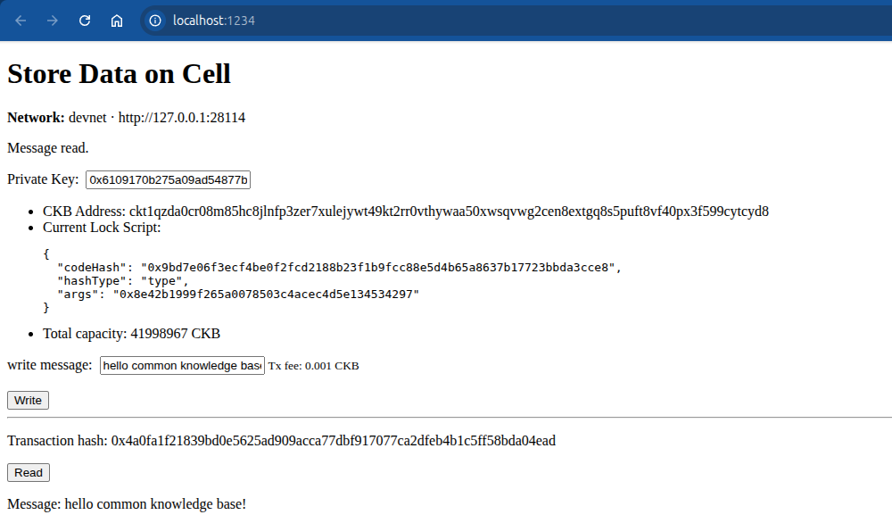
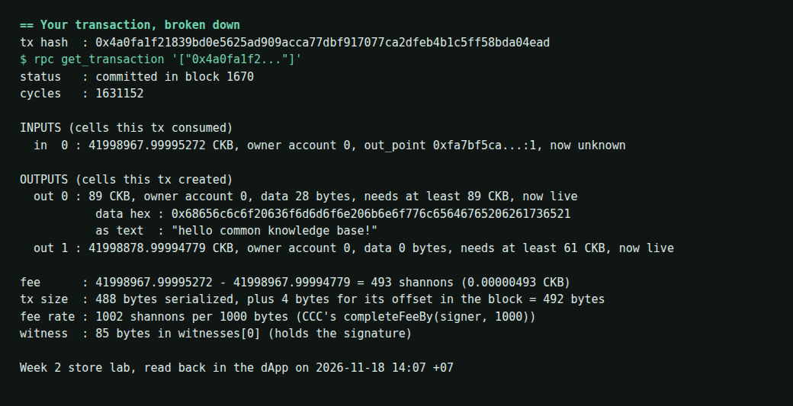

# Week 2: Transfer CKB and Store Data on Cell

First published in this repo's README on 18 November 2026 in commit [a0870a7](https://github.com/sonson0910/CKBuilder/commit/a0870a7), and moved to its own file the same day.

**Name:** sonson0910

**Week ending:** 19 November 2026

**Reporting period:** 13 to 19 November 2026

## Courses Completed

- Completed the Transfer CKB tutorial.
- Completed the Store Data on Cell tutorial.

## Key Learnings

1. The fee is the difference between total input and output capacity. For my transfer, it was 465 shannons.
2. When I spend a cell, I can reuse the CKB it held as capacity.
3. My transfer used about 1.6 million cycles to run the lock script that checks the signature.

## Practical Progress

I ran both tutorial dApps from the docs repo against the local OffCKB devnet, using devnet account 0 as the sender.

- Transfer CKB: sent 62 CKB to devnet account 1. The transaction consumed one input cell and created two outputs: 62 CKB for the receiver and the change back to account 0. The fee was 465 shannons.
- Store Data on Cell: wrote "hello common knowledge base!" (28 bytes) into a cell. The cell holds 89 CKB, which is the 61 CKB minimum for a plain cell plus 1 CKB per byte of data. I then read the message back in the dApp.

## What Felt Easy or Challenging

Both labs went smoothly. I was confused when the dApp still said the message cell was "not live yet" after my first Store Data on Cell transaction was confirmed on-chain.

## Next Steps

I'll work through the Create Fungible Token tutorial in the Handbook. My next weekly report is scheduled for Thursday, 26 November 2026.

## Environment

Local OffCKB 0.4.13 devnet (CKB 0.208.0). The `simple-transfer` and `store-data-on-cell` example dApps from nervosnetwork/docs.nervos.org, served locally on port 1234.

## Evidence

These transaction hashes belong to the local devnet.

1. Transfer: `0x4370c4a722daf3194f0029f2b3c203f73709fd4d7704164d2d03a953c26b4984`. Committed in block 147, using 1,646,303 cycles. [Transaction breakdown](../evidence/week-2-transfer-breakdown.log).
2. First store write: `0x2aba70bbb733b3c0ba5cfa81346bd32cedea8ee56e483491291c7e3565a3008e`. Committed in block 223, but the dApp tab kept reporting that the message cell was not live yet. [Terminal output](../evidence/week-2-store-first-run.log).
3. Store write read back in the dApp: `0x4a0fa1f21839bd0e5625ad909acca77dbf917077ca2dfeb4b1c5ff58bda04ead`. Committed in block 1670, using 1,631,152 cycles. [Transaction breakdown](../evidence/week-2-store-read-breakdown.log).

