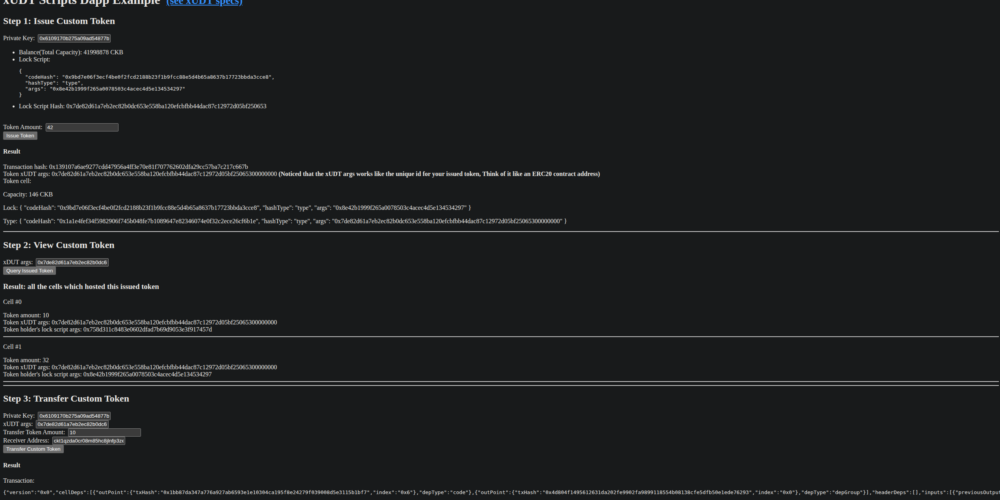
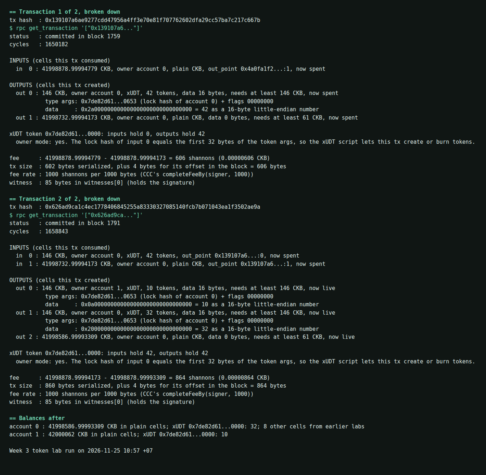
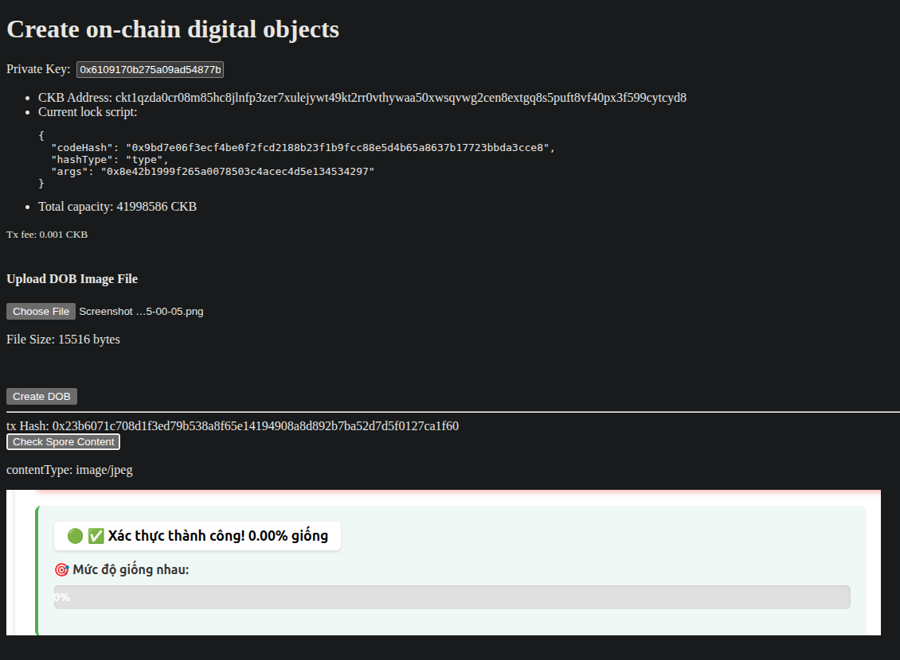
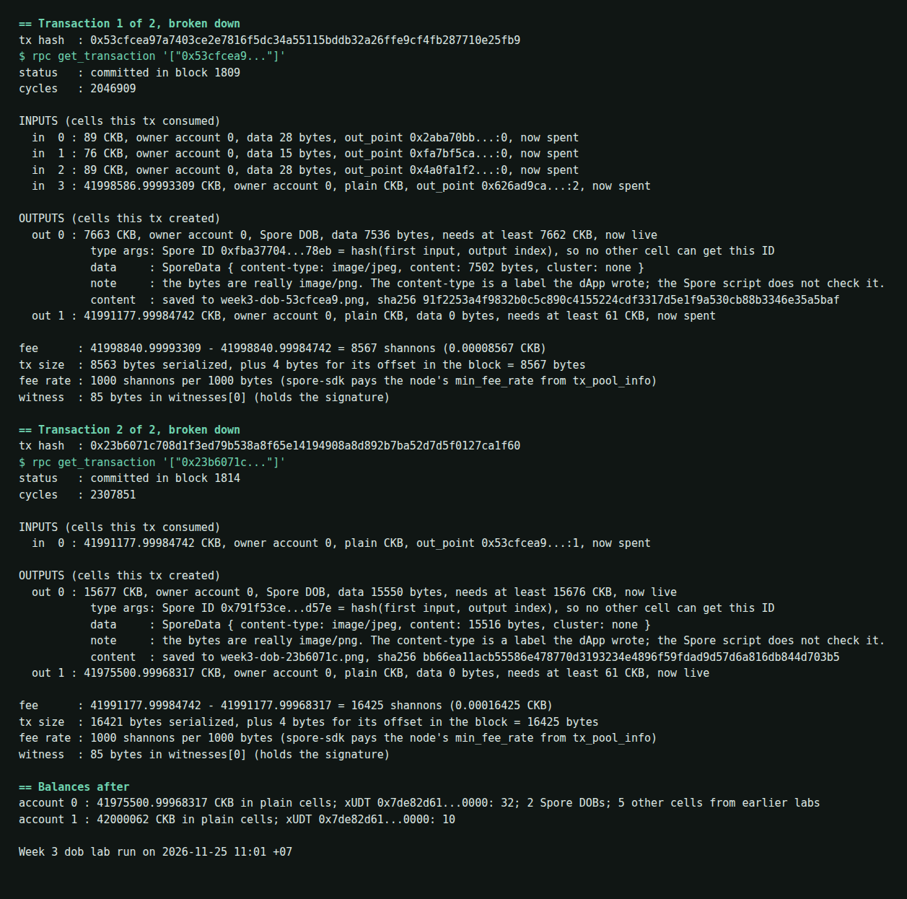

# Week 3: Create a Fungible Token and a DOB

**Name:** sonson0910

**Week ending:** 26 November 2026

**Reporting period:** 20 to 26 November 2026

## Courses Completed

- Completed the Create Fungible Token tutorial (xUDT).
- Completed the Create DOB tutorial (Spore).

## Key Learnings

1. A token's ID is its xUDT args: the issuer's lock hash followed by four flag bytes. Only a transaction that spends a cell locked by the issuer can mint more. When I tested this on the devnet, the node accepted account 0 minting 5 new tokens and rejected account 1 turning its 10 tokens into 11 (xUDT error -52).
2. For anyone who is not the issuer, the token outputs may not add up to more than the inputs. My transfer split 42 tokens into 10 and 32. In the same test, account 1 could send 4 of its 10 tokens and keep 6, or burn 4, but it could not create any.
3. Each byte of a cell, including its lock, type and data, needs 1 CKB. A token cell needs 146 CKB, and the node rejected one that held 145. My second DOB stored a 15,516-byte image; with the 34 bytes of SporeData around it and the lock and type scripts, the cell needs at least 15,676 CKB, and it holds 15,677.

## Practical Progress

I ran both tutorial dApps from the docs repo against the local OffCKB devnet, using devnet account 0.

- Create Fungible Token: issued 42 tokens from account 0. The token's ID (its xUDT args) is account 0's lock hash followed by four flag bytes `00000000`. The token cell holds 146 CKB and stores the amount as a 16-byte number. I then sent 10 tokens to devnet account 1. The transfer consumed the 42-token cell and created two token cells: 10 for account 1 and 32 back to account 0. Querying the token in the dApp afterwards showed both cells.
- Create DOB: created two DOBs from account 0. The first stored a 7,502-byte image. The second stored a 15,516-byte image in a cell that holds 15,677 CKB, and I read it back in the dApp with Check Spore Content. The first DOB transaction also used my two Store Data on Cell message cells from week 2 as inputs, so those cells are now spent.
- After the labs, I checked the token rules with five test transactions. The node verified each one with `test_tx_pool_accept` and did not commit any of them. All five gave the expected result.

## What Felt Easy or Challenging

Issuing the token and creating a DOB each took one click in the dApps. The token transfer needed a receiver address, and the dApp does not list the devnet accounts, so I had to get account 1's address from `offckb accounts`. The transfer result shows the whole transaction but not its hash, so I found the hash on the chain afterwards. The DOB dApp labels every upload as `image/jpeg`, even though my file was a PNG.

## Next Steps

I'll work through the Build a Simple Lock tutorial, the last Beginner tutorial in the Handbook, and try CCC in the CCC Playground. My next weekly report is scheduled for Thursday, 3 December 2026.

## Environment

Local OffCKB 0.4.13 devnet (CKB 0.208.0). The `xudt` and `create-dob` example dApps from nervosnetwork/docs.nervos.org, served locally on port 1234. The `create-dob` dApp builds its transaction with `@spore-sdk/core`.

## Evidence

These transaction hashes belong to the local devnet.

1. `0x139107a6ae9277cdd47956a4ff3e70e81f707762602dfa29cc57ba7c217c667b` issued 42 tokens. Committed in block 1759, using 1,650,182 cycles.
2. `0x626ad9ca1c4ec1778406845255a83330327085140fcb7b071043ea1f3502ae9a` sent 10 tokens to account 1. Committed in block 1791, using 1,658,843 cycles.
3. `0x53cfcea97a7403ce2e7816f5dc34a55115bddb32a26ffe9cf4fb287710e25fb9` created the first DOB. Committed in block 1809, using 2,046,909 cycles.
4. `0x23b6071c708d1f3ed79b538a8f65e14194908a8d892b7ba52d7d5f0127ca1f60` created the second DOB, which I read back in the dApp. Committed in block 1814, using 2,307,851 cycles.

Transaction breakdowns: [token](../evidence/week-3-token-breakdown.log), [DOB](../evidence/week-3-dob-breakdown.log). Token rule tests: [output of the five test transactions](../evidence/week-3-xudt-checks.log).

